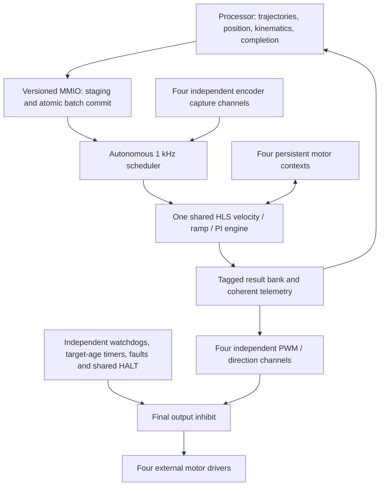

# Engineering Design Prompt
## DMOTOR — Shared Four-Motor FPGA Velocity Controller
**Revision 0.18 — Shared Velocity Engine and Processor-Owned Motion**
**Updated:** 2026-10-11
**Workspace:** `~/workspace/dmotor`

**Primary target:** AMD Zynq-7000 `xc7z020clg400-1`, Vitis HLS, 20 MHz
**Portability target:** Microchip PolarFire SoC / SmartHLS; separate qualification required
**Vivado reference:** `~/workspace/dvrmc/dvrmc.xpr`; [integration notes](docs/vivado_reference.md)
**Driver selection:** Pololu DRV8263H carrier #5238; electrical adapter validation remains open

**Status:** Recommended implementation architecture, with the user decisions below
approved. The shared calculation engine has scoped HLS evidence. The standalone atomic batch
protocol now implements publication, tick reservation and retirement with a draft
generated ABI; see [implementation status](docs/atomic_mailbox.md). Target-age
protection, batch-to-engine/output integration, the multi-channel scheduler and
complete board integration remain requirements to implement and measure.
The active full-profile control sources and legacy ring ABI have not been replaced
by this document update.

This revision supersedes the single-controller duplication, FPGA position/dwell
execution, and command/completion-ring requirements of revision 0.17 for the new
velocity profile. The [archived specification](docs/DMOTOR_ARCH_0_17.md) records the
previous implementation contract and decision history. Existing tests and reports
remain evidence for their original scope; they do not establish the new ABI.

### 1. Architectural recommendation and evidence

Use **one shared, sequential C++ HLS velocity engine for up to four motors**, with
separate persistent state for each motor. Keep encoder capture, PWM generation,
authorization timers, target-age timers, fault capture and final output inhibit
independent of that shared engine. A hardware scheduler drives all HLS transactions;
the processor never has to start each control tick.

The processor owns position moves, trajectories, dwell/sequence execution,
vehicle kinematics, position completion and external localization/compensation.
It publishes velocity targets through an atomic mailbox. The FPGA owns bounded
acceleration/deceleration, velocity estimation, PI control and protective response.
There is no FPGA position-move interpreter or command/completion ring in this profile.

Start from the measured explicit context load/update/store implementation. Do not
assume that direct in-place context access is cheaper: those four-context compiler
runs were stopped without a resource result. Use the exact bounded milliRPM
arithmetic and shared one-phase divider, rather than the less effective Q7 candidate.

| HLS estimate, 20 MHz | Four independent mailboxes* | Shared four-context engine |
|---|---:|---:|
| LUT | 70,356 | 25,894 |
| FF | 28,764 | 32,416 |
| DSP | 80 | 20 |
| BRAM18K | 0 | 0 |
| Maximum service latency | 324 cycles each, parallel | 333 cycles |
| Maximum service interval | 325 cycles each | 334 cycles |
| Estimated critical path | 35.251 ns each | 35.578 ns |

*Independent resources are arithmetic sums. Shared synthesis uses Vitis 2026.1.
Sharing saves 44,462 LUT (63.2%) and uses 48.7% of the device LUT capacity. Four
reserved service intervals take 1,336 clocks / 66.8 us before wrapper overhead.
The effective HLS timing budget is 36.50 ns after uncertainty. These estimates
exclude the new batch protocol, target-age timers, multi-channel integration and
place-and-route. The nominal 27,306 remaining LUTs are not a guaranteed integration
margin. See [shared-engine measurement](docs/shared_mailbox.md) and
[verification record](docs/verification.md).

### 2. Decisions and scope

| ID | Decision | Status |
|---|---|---|
| A01 | Shared four-context velocity engine with independent per-motor protection and I/O | Recommended architecture based on measured experiment; integration pending |
| A02 | Processor owns position, trajectories, dwell and completion; FPGA owns velocity/PI/ramp/PWM/protection | APPROVED by user, 2026-10-11 |
| A03 | Separate per-motor target timeout; expiration requests shared HALT | APPROVED by user, 2026-10-11 |
| A04 | Selected motors receive a coordinated batch atomically at one control tick | APPROVED by user, 2026-10-11 |
| A05 | Initial 100 Hz target publication, 100 ms target timeout; configurable and subject to scheduling measurements | APPROVED starting profile, 2026-10-11 |
| A06 | A newer pending batch replaces an older one only with an identical motor mask; partially overlapping masks rejected | APPROVED by user, 2026-10-11 |
| A07 | Target-age timer runs during velocity tracking; READY is zero-drive, STOPPING uses its stop deadline; authorization watchdog runs in every enabled state | APPROVED by user, 2026-10-11 |

Previously approved requirements retained: at most four motors; HLS-first design;
all qualified protective faults stop all motors; watchdog refresh throughout
READY/RUNNING/STOPPING with expiration winning simultaneous refresh; disable/coast
on HALT; Pololu DRV8263H #5238; 1 RPM minimum supported steady speed; zero drive
after position completion; final-system position tolerance and external pose
compensation; integration-owned electrical design; test-led MMIO freeze permitting
new registers during development. Revision 0.17 decision D08's ring mechanics are
superseded by A02/A04/A06; its watchdog and immediate-stop protections remain.

### 3. Partition and data flow

| Processor | Shared HLS engine | Independent FPGA infrastructure |
|---|---|---|
| Absolute/relative position trajectories and completion | Count/period velocity estimator | QA/QB synchronization, decoding, edge/count capture |
| Differential drive, geometry, localization and slip compensation | Exact rational encoder conversion | Free-running timestamps and coherent snapshots |
| Dwell, sequence queue and per-command history | Per-motor acceleration/deceleration and reversal behavior | Four PWM/direction outputs and safe direction switching |
| Validated configuration and periodic target batches | PI, saturation, anti-windup, acquisition/feedback qualification | Per-motor authorization/target-age timers and stop-deadline monitoring |
| Explicit watchdog refresh and recovery coordination | Per-motor persistent algorithm state | Shared fault latch, deadline monitor, late-result rejection, inhibit |

Prefer portable C++ HLS wherever budgets permit. Minimal RTL remains appropriate
for synchronization, bus/handshake adaptation and protection that must work when
HLS stalls. Existing tested RTL encoder/PWM blocks remain the initial implementation;
replacing them with HLS requires equivalent evidence. Vehicle geometry never
enters the shared calculation core. SmartHLS support remains a deliverable, not an
inferred consequence of successful Vitis synthesis.

### 4. Motor profile and numeric contract

Reference motor: JGA25-370, 6 V, 130 RPM no-load output speed ±10%, 46.8:1 gearbox.
User-supplied no-load/rated/stall currents are 0.1/0.5/2.6 A; rated/stall torque is
0.8/4.4 kgf·cm. These are design inputs, not measured continuous stall capability.

QA/QB provide 11 pulses per channel per motor-shaft revolution; X4 decoding gives
44 counts per motor revolution and **10296/5 = 2059.2 counts per output revolution**.
Never round this to an integer counts-per-revolution parameter. Position counters
are integer encoder counts; host conversion preserves fractional residuals.

The initial bounded profile supports up to 200 RPM output-shaft speed and up to
100 mm wheel diameter. Diameter is host geometry metadata, not a required FPGA
register. Supported minimum nonzero steady-state speed is 1 RPM in both directions;
startup/stopping may pass through lower speeds. Loaded performance requires testing.

Retain public signed milliRPM units. Validate range before narrowing: the measured
exact candidate uses a 19-bit velocity envelope, 20-bit PI error and 37-bit integral
at 1 kHz. Keep sufficient intermediate widths and explicit rounding/saturation;
not every register becomes 19 bits. Preserve the shared exact one-phase divider,
including the specialized PI division and wider estimator arithmetic where needed.
Changing rate, gains or operating bounds requires re-derived widths and tests.

Retain 64-bit cumulative position, event counts and timestamps for host odometry
and telemetry; removing FPGA position control does not remove position reporting.
No local-position rebasing scheme is adopted. Timestamp interval comparisons must
stay below half the modulo wrap interval; sticky diagnostic counters saturate.

Keep hybrid count/period estimation, invalid-transition exclusion, direction-change
qualification, sample age/validity and zero-speed detection. Reference zero timeout
is 100 ms; at 1 RPM the nominal edge interval is about 29.14 ms. A 1 kHz loop does
not imply fresh encoder information every millisecond. Preserve bounded acquisition
with capped effort, anti-windup and fault-on-failed-acquisition behavior. Detailed
algorithm bounds and existing numeric tests remain applicable; changes require
explicit evidence. See [bounded velocity analysis](docs/bounded_velocity.md).

### 5. Atomic target mailbox

Use a small staging area and **one immutable pending batch**, plus active targets
in the motor contexts. There is no trajectory FIFO. The initial integration uses
one pending slot for the entire engine to minimize protocol state.

A batch contains a nonzero motor mask within the implemented channels, an engine
session, a strictly increasing publication sequence, and a complete target and
configuration generation for every selected motor. Unselected motor entries have
no effect. Wire layout, widths and offsets will be generated from the new ABI
schema; the experiment's request/reply arrays are not that schema.

Publication is staged full-word writes, platform device-write ordering/completion,
then an atomic commit. Hardware validates all selected fields and tokens before
accepting any of them. Bad masks, incomplete fields, invalid ranges, stale sessions,
repeated/reordered sequences, or unavailable selected motors reject the entire
batch without changing active or pending targets. Rejection is diagnostic, not
by itself a protective fault. Rejected publication cannot renew target age.

While pending, a fully valid newer batch with the **same mask** may replace it.
A different mask is rejected until that slot is consumed or invalidated; this
includes disjoint masks in the initial single-slot implementation. Software can
combine disjoint updates into one batch. Never partially merge an overlapping
batch or silently discard only some selected motors. Partial staging cannot mutate
pending state. Sequence numbers may skip due to replacement; no per-command
completion history is promised. No sequence/session reuse without drained reset.

At a control boundary, the scheduler revalidates the entire batch against live
sessions, configuration generations, authorization and lifecycle state. Activation
occurs for all selected motors or none. If any selected motor is temporarily not
ready, hold the batch intact; active targets remain governed by their existing
age limits. If ownership becomes invalid, reject/invalidate the whole batch.
Unselected motors retain their targets and keep aging independently.

The batch logically activates at a common tick even though calculation is
sequential. Publish applied batch sequence, mask and effective tick together after
successful evaluation. Provide per-motor applied sequence and target age, plus
accepted/pending/rejected status, so software can distinguish acceptance from
application. Application acknowledges installation, not achieved physical speed.

### 6. Target freshness and authorization

There are **two separate protections**. A valid watchdog refresh authorizes the
controller to remain enabled. A fresh applied target proves that velocity intent
is still being supplied. Neither operation refreshes the other timer.

Initial processor target publication is 100 Hz (10 ms period). Target age timeout
is 100 ms per motor, configurable while disabled. These are initial engineering
values; host scheduling jitter and integration measurements must validate them.
Repeated application of the same numerical velocity with a fresh valid sequence
is allowed and renews intent. Replayed sequences, rejected commits, unapplied
pending batches, reads and watchdog refreshes do not renew target age.

- DISABLED/HALTED: outputs inhibited, target-age timer inactive.
- READY: zero requested drive, no active velocity tracking; target-age timer inactive.
- RUNNING: timer starts/renews at actual batch activation for each selected motor.
  This includes tracking a zero velocity target; zero target is not a promise of
  zero commanded drive from a PI loop.
- STOPPING: invalidate external targets and stop target aging; the bounded local
  stop operation has its own independent deadline. Authorization watchdog remains active.

Target age is measured from the common effective tick, not sequential computation
finish time. Expiration uses elapsed >= limit and wins same-boundary target
activation. Expiration of any tracking motor inhibits all motors and latches
shared HALT. No late target or watchdog write automatically resumes motion.

Retain a separate authorization watchdog per enabled motor. Explicit enable arms
it; refresh is required in READY, RUNNING and STOPPING. Expiration wins simultaneous
refresh or enable. Refresh uses the current session and monotonic refresh sequence;
old/replayed refreshes are rejected. Timeout remains configurable in the existing
proposed 1,000..10,000,000 us range, zero invalid. Recommend normal refresh at most
one third of its timeout. Its chosen value is separate from the 100 ms target-age
limit. Disable/HALT disarms only after inhibition is established. Neither processor
queues nor shared arithmetic excuse a missing refresh.

### 7. Lifecycle, stop and position completion

States are DISABLED, READY, RUNNING, STOPPING and HALTED. A separate engine-busy
indicator denotes an in-flight HLS transaction; it does not mean a trajectory is
complete or a motor is stationary.

Power-up is inhibited with admission closed and configuration invalid. Explicit
enable requires validated configuration, a drained initialized session, no live
mandatory fault and no protective latch. Publication alone cannot enable drive.

Immediate controlled STOP is out of band, outranks publication and clears affected
pending/active intent. If it intersects a pending coordinated batch, invalidate
that entire batch. Close admission to stopped motors, decelerate under the existing
ramp/feedback rules, then enter READY with **zero drive**, without active holding.
Use configured speed threshold and settling duration, plus a bounded stop timeout;
expiration is a protective fault. New motion requires an explicit rearm/session
transition after stop, preserving the prior no-automatic-restart rule. HALT or
immediate disable never waits for controlled deceleration.

The processor detects position completion using the final-system tolerance and
external pose estimates. It requests controlled STOP and confirms READY/zero-drive
before reporting that the motor's drive has completed. A zero velocity target
alone does not satisfy the zero-drive requirement. Position accuracy, slip, drift
and allowable overshoot remain vehicle acceptance measurements. No FPGA position
hold or exact mechanical standstill claim is made.

Dwell and trajectory queues reside in processor software. During velocity tracking,
a dwell still requires target publication and watchdog refresh. During READY,
watchdog refresh remains required. Host trajectory acceleration and the FPGA's
local ramp limits must be coordinated; the FPGA limits remain authoritative.
Open-loop duty commands are excluded from the normal runtime mailbox; any future
commissioning mode requires a separate bounded, authorized interface review.

### 8. Shared scheduler and PWM application

Every 1 ms tick captures a coherent snapshot of all enabled motors, selects any
eligible pending batch, and services all enabled contexts using one HLS call site.
Only one transaction is in flight. Store motor ID, session, configuration generation,
batch ID and tick with each computation; check them again before accepting results.
Hold inputs according to the generated HLS handshake.

Reserve the control window ahead of ordinary mailbox traffic. Do not accept an
unbounded stream of register transactions into the computation engine. Implement
a small independent staging/commit interface where practical; configuration and
telemetry accesses must not block watchdog/inhibit or periodic control. Account
for any already accepted service when proving the scheduling bound.

Stage the complete tick's duties before releasing them at a common PWM boundary.
This prevents different motors from applying a coordinated update on different
PWM cycles. If a result faults or the frame misses its deadline, inhibit globally
and discard the entire result frame. Do not apply a partially completed frame.
The prior single-channel 'first PWM boundary after each result' rule is superseded
by 'first common PWM boundary after the complete frame'.

Snapshot bank, result bank, mask, generation and valid bits are explicit state.
Invalidate them on stop, disable, configuration/session changes and faults as
appropriate. A late result cannot re-enable a motor or install a superseded target.
Engine reset or loss of its global scheduling state inhibits all motors; recovery
resets/drains the engine and requires explicit reinitialization.

### 9. Protection and recovery

Protective priority is HALT/fault/expiration, then disable, then controlled stop,
then target activation. This priority also applies at publication, computation
retirement and PWM boundaries. Final inhibit is independent of HLS and PWM phase.

Every qualified local protective event latches its cause, asserts local FAULT_OUT
and shared HALT_OUT, and inhibits all participating motors. Classes include driver,
supply, thermal, overcurrent, configured travel-limit/stall/encoder faults,
arithmetic range faults, authorization or target-age expiration, stop timeout,
and shared-engine deadline/overrun. Mandatory HALT cannot be masked. Additional
physical inputs need explicit polarity, qualification and class assignment.

Receiving external HALT records a separate external latch; it does not fabricate
a local cause or echo HALT_OUT. Preserve all simultaneous causes and timestamps;
use the lowest fault bit as deterministic first-cause tie-break. Independent sticky
fault/abort records cannot be blocked by telemetry or mailbox occupancy. Report
motor mask, cause, active/applied batch and effective tick when available.

Protective output intent is disable/coast, zero requested drive, no active braking.
Preserve direction while inhibited. The adapter uses a dedicated inhibit path;
zero PWM alone is not a coast contract. Mechanical stopping time and electrical
turn-off delay are separate from the FPGA digital-inhibit budget.

Recovery order: correct the live source; acknowledge local causes to release local
HALT_OUT; release the external latched aggregator; wait for inactive HALT_IN;
acknowledge the external latch; drain/reset stale work; explicitly enable/rearm.
No refresh, new target, or peripheral reset may bypass the aggregator or restart
motion. Enumerate bus, peripheral, scheduler and fabric reset domains. A local
reset must not clear a shared protective latch. Fault or stop invalidates pending
intent; outstanding AXI writes need a proven drain/isolation contract before
session reuse. Tokens alone do not solve cold-reset stale transactions.

### 10. Configuration and MMIO

Use per-motor validated active configuration banks. Prepare rational conversion,
limits and derived constants while disabled. Start with the measured context
representation; optimize cold state or configuration sharing only after another
measured comparison. Never share mutable PI/estimator history between motors.

Configuration commits require the affected motor disabled, no in-flight access
to its context, and no pending batch referencing it; increment its configuration
generation and reset affected history. Clock/global scheduler changes require all
motors disabled. Do not add live retuning in this revision.

Expose version/capabilities and motor count, global session/batch status, per-motor
configuration, explicit enable/disable/stop/rearm, watchdog refresh/status,
target-age limits/status, coherent telemetry, fault attribution and measurement
hooks. Telemetry includes 64-bit position/count/time, velocity validity and sample
age, commanded/ramped/measured speed, duty, state, applied batch, timing maxima,
deadline misses and sticky rejection diagnostics.

Retain ordered 32-bit aligned full-word MMIO semantics and specified invalid-access
responses. Action registers are command strobes; status reads have no destructive
side effects. Fault acknowledgment validates the source is inactive. A new event
wins over simultaneous diagnostic clear. Snapshot data carries sequence and time.

Generate matching C++/RTL/host definitions from a provisional machine-readable
schema. Give the mailbox profile a distinct version/capability identity from the
ring profile. Do not silently reinterpret legacy descriptor offsets. New registers
are permitted as integration exposes needs. Freeze only after protocol, numeric,
integration and generated-interface tests pass; post-freeze changes need explicit
compatibility review. No arbitrary memory-map-size restriction is imposed.

### 11. Named timing profile

All timing values and conversions shall be named constants or validated runtime
configuration. Continue using `abi/timing.json`, `abi/registers.json` and generated
C++/RTL timing definitions; new batch/target-age constants must be added there
when implemented. Do not scatter cycle literals through step functions or tests.

| Quantity | Initial target / interpretation |
|---|---|
| Fabric clock | 20 MHz, 50 ns per clock |
| Control period | 1 kHz, 1,000 us / 20,000 clocks |
| PWM period | 20 kHz, 50 us / 1,000 clocks |
| Processor target publication | 100 Hz / 10 ms, initially; configurable host policy |
| Per-motor tracking target timeout | 100 ms / 2,000,000 clocks initially; configurable while disabled |
| Complete shared control-frame deadline | Before 800 us / 16,000 clocks from tick; equality loses |
| Measured shared engine reservation | 4 × 334 = 1,336 clocks / 66.8 us, excludes integration overhead |
| Complete-frame duty release | First common PWM boundary after all validated results; at most one PWM period later |
| External HALT to FPGA logical inhibit | At most 10 us / 200 clocks; act immediately, no intentional delay |
| Synchronized HALT to logical inhibit | Existing target at most 2 clocks; independent of arithmetic/bus/PWM |
| Local HALT pipeline regression | Existing 5-clock / 250 ns test bound; not a whole-network or analog guarantee |
| MMIO response | Retain proposed 2,048-clock / 102.4 us target from complete accepted request to response VALID, excluding master response backpressure; re-prove for new arbitration |
| Encoder capture | At least 100,000 valid transitions/s per channel, declared minimum state dwell 200 clocks |
| Reference zero-speed timeout | 100 ms; separate from target timeout despite equal initial value |

The control-frame deadline includes arbitration, context transfer, calculation and
result validation. The old one-clock launch assumption for every independent
motor cannot be applied to a sequential engine; measure launch skew and full-frame
completion instead. A common output boundary follows successful frame validation.

Mandatory HALT must remain asserted until acknowledged, or use separately verified
pulse capture. Synchronizer CDC/metastability analysis is separate from digital
RTL latency. Measure source fault through aggregator to all destinations; do not
report a local five-clock test as a network bound. Board-level clock/power-loss
inhibition requires external-safe biasing/adapter design, not a stopped-clock counter.

### 12. Driver and physical integration

Retain the approved Pololu DRV8263H #5238 and disable/coast intent. Record the exact
received board revision and verify its control mode, DRVOFF inhibit connection,
FAULT routing, current-limit components, analog current-sense interface, reset
biases and FPGA-unconfigured/clock-loss/power-sequencing behavior. The prior
[board assessment](docs/DMOTOR_ARCH_0_17.md#d03c-selected-board--2026-10-11) remains
reference material; this architecture update does not requalify electrical limits.

The carrier default current limit is not assumed to protect the motor. Select
limits from startup/load torque, permitted stall duration and thermal measurements.
Hall inputs are independent FPGA QA/QB inputs with validated voltage levels.
Position tolerance, 1 RPM loaded control, drift and stopping distance are validated
on the tracked vehicle. No current-limit or mechanical-safety claim follows from
HLS simulation.

### 13. Verification and implementation sequence

1. Define the new machine-readable mailbox ABI and host reference driver. Implement
   complete batch staging, same-mask replacement, generation/session validation and
   atomic activation. Test reordered/partial writes, invalid masks, overlapping and
   disjoint rejection, replay/wrap, unavailable channels and stale bus transactions.
2. Add independent per-motor target-age protection and retain authorization watchdogs.
   Test expiration against simultaneous refresh/activation/stop; renew only on
   valid applied intent. Verify RUNNING/READY/STOPPING lifecycle rules and shared HALT.
3. Integrate an autonomous four-context scheduler, coherent encoder snapshots,
   result tagging, common PWM commit and global deadline protection. Inject a
   stalled HLS transaction, bus saturation, fault mid-frame, late results, resets
   and overlapping stop/batch operations. Prove no partial duty-frame application.
4. Run native numerical/protocol tests and generated-RTL integration/co-simulation.
   Compare interleaved contexts with independent references, verify full 64-bit
   telemetry coherence, and preserve rational precision and range checking.
5. Synthesize and place/route the complete four-motor design on `xc7z020clg400-1`.
   Report LUT/FF/DSP/BRAM, worst-case full-frame and MMIO latency, timing slack and
   CDC review. Repeat resource measurement after adding batch and protection logic.
6. Validate the processor loop's publication/refresh jitter under load, vehicle
   trajectory-to-velocity behavior and completion-to-zero-drive sequencing. Test
   missed target updates even while watchdog refresh continues. Adjust numerical
   budgets only with documented rationale and affected-test review.
7. Complete electrical/loaded-motor and vehicle acceptance; perform separate
   SmartHLS synthesis/integration qualification. Freeze release ABI after applicable
   tests and integration requirements pass.

Current evidence: 16 applicable native/RTL tests and shared-engine HLS C/Verilog
co-simulation pass; 1,673 interleaved transactions compare every reply word with
four independent mailbox contexts. Existing standalone mailbox tests also compare
control snapshots against the Controller oracle. These tests do not cover the new
atomic multi-motor batch, target-age timers, autonomous four-channel wrapper,
physical HALT distribution or routed device fit. See [measurement](docs/shared_mailbox.md).

### 14. Remaining engineering decisions

The user decisions A02–A07 above are resolved. No unanswered preference is silently
adopted as authorization. Remaining design work includes the processor runtime and
measured scheduling envelope; authorization watchdog and controlled-stop deadline
values; host trajectory law and completion tolerances; numerical gain/filter and
acquisition parameters; exact ABI layout; electrical adapter qualification; and
SmartHLS platform constraints. Use existing validated algorithm bounds initially,
and ask the user when a choice changes external behavior or the supported envelope.

The starting implementation is the measured load/store shared engine, not a claim
that its state layout is optimal. BRAM-backed cold state, prepared configuration
banks and unused completion metadata removal remain later measurement candidates.
Do not delay the new scheduler/protection integration for speculative arithmetic
changes already shown to have smaller benefit.
