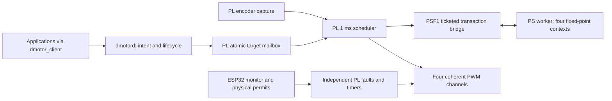

# DMOTOR architecture — PS motor executor, 1 ms

The default product uses the Zynq PS for four-wheel fixed-point velocity estimation,
ramps, PI, acquisition and STOP state. The PL retains encoder capture, coherent
four-wheel scheduling/PWM, the atomic target mailbox and independent protection.
The ESP32 remains the independent monitor. The control loop stays **1 kHz / 1 ms**;
the fabric stays **20 MHz**. The 5 ms experiment is not selected on main.

## Ownership and data flow

The daemon owns the exclusive driver descriptor. Runtime owns client leases,
authorization refresh, target publication and explicit lifecycle decisions. Its
worker services fabric-issued requests; it cannot renew leases, prepare, enable,
release HALT or silently restart itself. Control state uses ordinary PS memory;
no PL DRAM master, DMA or state ring is required.

PL deadlines and electrical protection continue when the worker stalls. The
scheduler's original **800 us full-frame deadline** remains; expiry or overrun
inhibits output. Encoder/PWM clocks and the 20 kHz PWM period are unchanged.
A reply is valid only for the current immutable 64-bit ticket and complete response.
Late or cancelled replies cannot refresh output or advance committed PS state.

## Preserved product contracts

- Up to four motors, signed milliRPM, commissioned limits up to 400 RPM and
  exact rational encoder scaling. Per-channel configuration/generation, readiness,
  bounded acquisition, fractional ramps, PI anti-windup and STOP settling remain.
- Existing DMI2 configuration/status/telemetry and DMB1 atomic target registers;
  four-wheel publication and common-boundary PWM application remain coherent.
- Authorization watchdogs, target-age checks, hardware STOP deadline, encoder
  diagnostics, shared HALT, physical faults, heartbeat supervision and CLN1 cleanup.
- Single-motor direct-duty commissioning remains a separate bounded mode.
- Applications use dmotor_client. Board-facing ports, board constraints, UART and
  ESP32 protocol/pins are unchanged. The private PSF1 aperture is inside the
  existing 64 KiB AXI range and requires the matched driver/daemon.

No FPGA position/dwell interpreter is restored. Vehicle kinematics, navigation and
position planning remain higher-level PS work. No additional ESP32 offload is added.

## Build and evidence

Normal sources now contain the prepared 400 RPM fixed-point implementation;
there is no product patch-preparation step or shared motor HLS build. Only the
atomic mailbox remains HLS. See [build instructions](docs/build.md),
[PS executor/ABI details](docs/ps_executor.md), [current status](docs/system_status.md)
and [verification](docs/verification.md). Main uses software version 0.10.0 and
controller IP revision 13, with PSF1-1000us provenance.

The sandbox's 1 ms full-controller OOC route used 9,542/13,300 slices, versus
13,250 previously (28% fewer), with +6.543 ns setup and +0.096 ns hold slack.
These are standalone controller figures; current main's full-board results and
matched ARM/image evidence are recorded separately in system_status.md.

Hardware testing remains paused pending assembled monitor and motor boards.
U0 UART results remain historical evidence for their recorded image; U1 GPIO/HB
is implemented/build-tested but physically unaccepted. A new image needs its own
inhibited regression when testing resumes. Neither native tests, RTL co-simulation,
ARM QEMU nor FPGA timing reports prove Linux control deadlines under actual load.
The 1 ms loop and 800 us frame budget require target measurements.

Commissioning remains the first release. Operational monitor firmware and full
live recovery/ARM coordination remain open; PL cleanup alone is not recovery.
The [previous architecture](docs/archive/pre-ps-executor-2026-11-07/DMOTOR_ARCH.md)
retains its historical HLS sizing and decision context.
