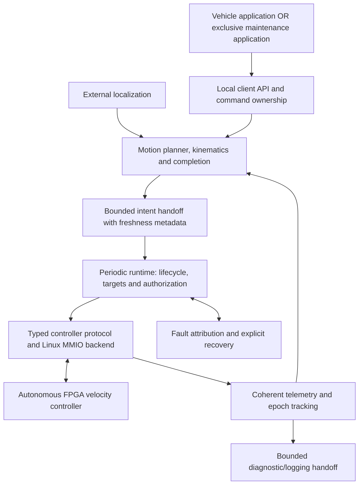

# DMOTOR processor software implementation plan

**Date:** 2026-10-14  
**Architecture baseline:** [DMOTOR_ARCH.md](DMOTOR_ARCH.md), revision 0.18  
**Initial platform:** Zynq-7000 ARM processor running EDF Linux on Arty Z7-20  
**Status:** Implementation started: Phase 0 semantic model and software tests; production runtime and hardware access remain pending.

## 1. Objective and scope

Implement the processor software that operates the shared, four-motor FPGA
velocity controller. Here, “host” means the ARM processor on the board. The
development workstation builds, deploys and inspects this software.

The processor owns position moves, trajectories, command queues, dwell,
vehicle kinematics, odometry, external position compensation and completion.
The FPGA continues to own its autonomous 1 kHz control loop, velocity estimation,
PI control, acceleration/deceleration limits, PWM and independent protection.
Software publishes intent; it does not start individual HLS transactions or PWM
cycles. Do not reintroduce the revision 0.17 FPGA command/completion ring.

Deliver a portable C++ runtime core, a Linux device-access backend, a single-owner
controller service, client/commissioning tools, tests and EDF packaging. Keep
platform access separate from planning and protocol logic. PolarFire support is
a later backend and qualification effort, not established by native C++ tests.

## 2. Existing foundations and implementation constraints

| Existing component | Reuse and remaining work |
| --- | --- |
| [controller_host.hpp](include/dmotor/controller_host.hpp) | Session, configuration, watchdog and telemetry reference helpers. Add concrete device access, typed validation, lifecycle orchestration and error handling. |
| [batch_host.hpp](include/dmotor/batch_host.hpp) | Publication and coherent applied-batch helpers. Add sequence ownership, scheduling, application tracking and bounded recovery from rejection. |
| `abi/controller.json`, generated controller registers and mailbox ABI | Use generated definitions; do not duplicate register offsets in the runtime. Validate supported identities and schema/capabilities where exposed. |
| [controller_host_test.cpp](tests/controller_host_test.cpp) and existing protocol/RTL tests | Extend the mock-I/O tests and reuse hardware protocol evidence. They do not establish Linux scheduling or device-memory ordering. |
| [controller_axi.md](docs/controller_axi.md) | Current lifecycle, register and telemetry contract. Reconcile discrepancies with the architecture before implementation. |
| [dev_probe.py](tools/dev_probe.py) | DMD1 permanently inhibited diagnostic endpoint only. It is not a driver or probe for the integrated DMI1 controller. |
| EDF Arty FPGA Manager integration | Provides the bitstream/overlay loading path. A Linux MMIO driver/backend and motion runtime still need development. |

Important current limitations must be represented explicitly in software:

- Configuration staging/commit currently requires core reset held. Numeric
  validation occurs during initial HLS service; “configured” does not mean ready
  to drive. Watchdog service is required during warm-up.
- STOP remains latched until disabled reset/rearm. Do not assume independent
  per-motor restart while peers continue running; establish the supported global
  reset/rearm sequence first. If continuous peer motion across another motor's
  stop/rearm is required, review the hardware contract rather than hide the gap.
- `CORE_RESET` preserves protective latches but resets engine, mailbox,
  encoder and time epochs. Position discontinuities must be visible to odometry.
- The architecture describes per-motor watchdog protection; the current endpoint
  exposes a shared watchdog timeout setting with per-motor refresh strobes.
  Do not offer independently configurable timeout values unless the ABI supports them.
- Hardware does not arbitrate multiple software snapshot/publication writers.
  The Linux backend must enforce exclusive ownership.
- Some architecture-level diagnostics and capabilities remain incomplete. The
  runtime must report unavailable information rather than synthesize a successful
  result or infer it from unrelated status bits.

## 3. Proposed software structure

Use one C++ service, provisionally named `dmotord`, as the sole hardware owner.
Applications submit commands through a versioned local client API rather than
mapping the registers themselves. These names and the layout below are proposals.



The periodic path owns all MMIO operations. Planning, IPC and logging must not
block it. Use bounded queues or snapshots between components, bounded retries,
and named deadlines. Avoid allocation, filesystem operations and synchronous
logging in the periodic path. Use monotonic absolute scheduling deadlines and
measure lateness; do not replay a backlog of expired periodic updates.

A separate healthy heartbeat must not conceal a dead planner or stale client
intent. Associate plans/commands with ownership and freshness state. The policy
for lost ownership or stalled planning must be explicit; hardware target-age and
watchdog expiration remain independent backstops.

Suggested additions, kept separate from the HLS sources:

```text
software/
  include/dmotor_sw/    Typed configuration, commands, telemetry and interfaces
  src/                 Protocol adapter, lifecycle, publisher, planner, odometry
  linux/               Device backend, ownership and Linux service integration
  apps/                dmotord, dmotorctl and separate dmotor-maint application
  tests/               Mock-device, runtime, planning and Linux integration tests
  config/              Versioned board/motor profiles; no implicit motion enable
```

Use explicit CMake targets so native tests and ARM cross-builds do not require
Vitis, Vivado or HLS-only dependencies. Preserve the existing firmware build and
test targets. Start with the repository's C++ baseline; changing it is a separate
build decision.

### Separate interactive debug and maintenance application

**User decision, 2026-10-14:** The manual interface is a separate application for
debug and maintenance only. It is not a test harness and does not run alongside
other tests. When the application exits, DMOTOR must HALT all motors.

Provide a dedicated terminal executable, provisionally `dmotor-maint`, usable over
serial console or SSH. It is separate from the normal vehicle application,
`dmotorctl` and automated test runners. It must not launch automated test suites
or be included as an interactive step in CTest/CI. Internal software verification
can still use mocks and scripted input without making the maintenance application
a test harness or exposing a mock operating mode in the deployed application.

The application uses the shared client API and validation; `dmotord` remains the
sole MMIO owner. Separate application does not mean a second register-access path.
Acquire exclusive maintenance ownership of the entire controller, not merely a
selected motor. Refuse acquisition while another application or hardware test owns
it; require an explicit inhibited handover. While maintenance ownership is active,
reject normal motion clients and other hardware tests. Release ownership only
through the HALT-on-exit lifecycle. Opening the application must not enable motion,
clear faults or automatically rearm the controller.

The initial menu exposes velocity commands, lifecycle operations and inspection.
Position/dwell commands become available only when the corresponding processor
planner is implemented; they are manual operations, not an automated test runner.
Unsupported operations must be shown as unavailable with a reason.

```text
DMOTOR maintenance — hardware connection and exclusive ownership status
Selected motors: [...]    Controller state: [...]    Faults: [...]

1  Select motor or motor group
2  Inspect live status, encoder counts and velocity
3  View/edit/apply motor configuration while disabled
4  Initialize/rearm and explicitly enable selected motors
5  Set individual velocity targets for selected motors
6  Controlled STOP selected motors
7  Disable selected motors immediately
8  Inspect faults and request explicit recovery
9  Position move / dwell [requires planner]
L  Start/stop diagnostic recording
!  HALT ALL motors
Q  HALT ALL motors and exit
```

Accept signed output-shaft RPM, validate it, and display selected motors, direction,
units and limits before issuing a command. Convert RPM to milliRPM without silent
truncation. Submit a multi-motor change as one atomic batch. Changing the menu
selection alone must not change any active target. An explicit command authorizes
motion within the maintenance session; do not impose a test-duration workflow or
interpret menu activity as a new motion command.

While maintenance motion is authorized, the service handles periodic target
publication and watchdog refresh independently of typing, display and diagnostic
recording. Maintain a monitored maintenance-session lease. Do not renew it from
an unrelated thread that can conceal a stalled client command loop. The lease
loss detection budget must be named and measured; normal pauses waiting for user
input must not prevent the application from servicing its lease.

Show requested/ramped/measured velocity, validity and sample age, encoder position,
duty, enabled/ready/stopped state, faults and accepted/applied batch progress where
exposed by the ABI. Label unavailable diagnostics and stale/disconnected displays.
Distinguish command acceptance, application and achieved physical behavior.

**HALT-on-exit is mandatory, not controlled deceleration.** Normal Quit, window or
terminal closure, Ctrl+C and handled termination request shared HALT for all motors,
invalidate maintenance intent, and verify the protective/inhibited state while the
connection remains available. Do not substitute a zero velocity target, controlled
STOP, or selected-motor disable for this contract. Keep HALT available during all
prompts using event-driven input and priority handling through the service.

A process cannot execute cleanup after SIGKILL, a crash or host failure. Therefore
the service must independently detect client death, disconnect or lease expiration
and assert the same shared HALT path. If the service/processor also fails, FPGA
authorization/target-age protection remains the independent backstop. Document and
measure the detection-to-inhibit bounds; an instantaneous response to an undetected
process failure is not promised. Loss of communication must not be reported as
confirmed HALT.

Bind the HALT request to the actual board's shared-HALT mechanism, including the
GPIO/aggregator integration where applicable. The current controller ABI must not
be assumed to contain a software HALT command merely because it exposes STOP and
DISABLE. Establish and verify this platform path before enabling maintenance
motion. The software request does not replace the independent physical HALT input.

After exit or lost ownership, retain HALT and reject stale commands. Reopening the
application or starting another client must not automatically clear HALT, replay
motion or resume drive. Recovery requires the explicit architecture-defined
acknowledgment and rearm sequence. Explain global reset/rearm effects before an
operator requests them.

**Acceptance:** Verify exclusive maintenance ownership against normal applications
and hardware tests; invalid inputs; atomic group commands; unavailable operations;
HALT during partially entered input; normal exit, Ctrl+C, termination, EOF,
SSH/serial disconnect, process crash and lease expiry. Verify that every exit/loss
path requests all-motor HALT, clears pending maintenance intent, and cannot restart
motion on reconnection. Exercise the application with ordinary input/display delays
and verify the service's periodic obligations continue. These are development and
qualification tests of the application, not features of a deployed test harness.

## 4. Contracts the runtime must preserve

| Area | Required software behavior |
| --- | --- |
| Periodic targets | Start with 100 Hz publication. Measure the scheduling envelope against the initial 100 ms tracking-target timeout; neither value is a measured Linux guarantee. |
| Watchdog | Refresh every enabled motor in READY, RUNNING, STOPPING and warm-up. Normal refresh interval should be at most one third of the selected authorization timeout. |
| Atomic publication | Stage all selected fields, complete device-write ordering, then commit. Use a nonzero session, increasing sequence and current per-motor configuration generations. |
| Pending slot | Replace a pending batch only with the same motor mask. Different masks, including disjoint masks, must wait or be combined before publication. Do not partially merge batches. |
| Application | Track accepted, pending, rejected and applied states separately. Only actual application renews target age; application does not mean achieved speed or position. |
| Units | Public velocity is signed milliRPM. Validate before narrowing; initial maximum is 200 output RPM and minimum supported nonzero steady speed is 1 RPM. |
| Geometry | Wheel diameter is host metadata, initially bounded at 100 mm. Use exact rational encoder conversion: 44 motor-shaft counts/revolution × 46.8 = 10296/5 output counts/revolution. Preserve fractional residuals. |
| Completion | Use final-system position tolerance and pose information, issue controlled STOP, then confirm READY/zero drive. Zero velocity alone is not zero drive or mechanical standstill. |
| Protection | HALT/fault/expiration outranks disable, controlled STOP and target activation. No target, refresh, process restart or reconnect automatically resumes motion. |
| Reset | Drain/isolate outstanding bus activity before session reuse. Changing a software token alone does not prove reset isolation. Record encoder/time epoch changes. |
| Timing | Keep host scheduling, watchdog, target-age, acquisition and stop deadlines distinct, named and validated. Derive hardware cycle values from the qualified timing profile. |

## 5. Implementation phases and acceptance gates

### Phase 0 — Establish the software/ABI contract

**Deliverables:** A supported-ABI table; typed motor configuration and telemetry
definitions; lifecycle transition table; named timing policy; error/status model;
and a deterministic fake-device backend with fault injection.

Map each software operation to current registers and identify missing hardware
observability. Specify session/sequence exhaustion behavior, configuration
generation changes, control ownership and reset-induced odometry discontinuities.
Do not treat retained legacy `motion.cpp` or ring APIs as the new runtime contract;
reuse algorithms only after adapting their semantics and tests.

**Acceptance:** Tests reject unsupported identities, invalid masks, malformed
configuration and out-of-range units. Every planned operation has either a tested
current-ABI sequence or a documented hardware dependency.

### Phase 1 — Linux access and inhibited inspection

**Deliverables:** Linux `Io` backend; exclusive device ownership; integrated
controller identification/status/telemetry tool; and device-tree/driver integration.

Evaluate a small kernel driver against UIO for the actual ordering, access-error,
ownership and FPGA-removal requirements. UIO is a candidate, not an assumption.
Document device-memory mapping attributes, aligned full-word access, the required
ARM device-ordering/completion mechanism and AXI error handling. A compiler fence
or ordinary cached pointer is insufficient. Do not make unrestricted `/dev/mem`
the production interface.

Discover the mapped resource from the device interface. The current DVRMC design
assigns a 64 KiB region at `0x43c00000`; keep that address out of portable logic.
Coordinate FPGA Manager loading with device creation and service startup. Refuse
access before the correct IP is available; prohibit reconfiguration while owned.
Initial attachment must not clear faults, enable motors or resume prior commands.

**Acceptance:** Mock ordering/error tests pass. On the board, identify the actual
DMI1 controller and capture coherent telemetry with outputs inhibited. Verify
second-owner rejection, unexpected identity, missing device and reset/removal
handling. Linux mapping and ordering need board evidence, not only native tests.
Develop the separate maintenance application against a mock service in automated
unit tests; deliver inhibited hardware status/telemetry views and exclusive ownership.

### Phase 2 — Configuration and lifecycle orchestration

**Deliverables:** Typed configuration encoder/validator; explicit initialization,
enable, disable, STOP and rearm operations; and readiness polling with deadlines.

Follow the current disabled/core-reset configuration sequence, establish a drained
session, stage and commit each complete configuration, then release reset and
explicitly enable selected motors. Refresh watchdogs throughout warm-up and wait
for actual readiness. Failure must leave motion inhibited or request inhibition
where access remains available; independent FPGA protection covers host failure.

Implement STOP as an out-of-band request that outranks normal queued commands.
Expose the current reset/rearm limitation to callers and preserve/mark odometry
epochs across it. Do not claim live retuning or independent per-channel rearm.

**Acceptance:** Test invalid configuration, warm-up timeout, missing refresh,
STOP during publication, disable during activity, and reset/rearm with peer motors.
No new target can bypass an incomplete lifecycle transition.
Expose configuration and lifecycle menu actions through these tested operations.

### Phase 3 — Periodic velocity and authorization runtime

**Deliverables:** Single-owner periodic executor, atomic batch publisher,
watchdog manager, applied-batch monitor, bounded command handoff and timing metrics.

Start with fixed velocity commands before adding position planning. Publish fresh
sequences at the initial 100 Hz rate, even for an unchanged numerical tracking
target. Coordinate selected-motor masks and handle same-mask replacement without
spinning on the pending slot. Keep authorization refresh separate from target
publication and track per-motor application/freshness.

Define what constitutes fresh processor intent. Repeatedly manufacturing new
sequences from an abandoned client command must not silently defeat the intended
stale-intent policy. A valid autonomous trajectory may continue without continuous
client traffic only under an explicit ownership/lease policy.

Measure wake-up lateness, publish-to-application delay, watchdog refresh gaps,
rejections and deadline misses under CPU, storage, network and telemetry load.
Choose Linux scheduling priority, memory locking and any CPU affinity from these
measurements. Do not assume a stock Linux scheduling bound or require a real-time
kernel without evaluating the actual envelope.

**Acceptance:** Four-motor publication and watchdog operation pass mock/RTL-backed
tests and board load tests. Verify missed target publication while refresh
continues, missed refresh while publication continues, stale/replayed sequences,
pending-mask conflicts and process stalls. Expiration must not lead to automatic
restart. This phase is the first velocity-only runtime milestone; it does not
establish loaded-motor qualification. Deliver maintenance single/group velocity
commands, live telemetry and the verified all-motor HALT-on-exit path. Do not
enable maintenance motion before that path and ownership-loss detection are tested.

### Phase 4 — Fault handling, recovery and operational tools

**Deliverables:** Typed fault records, explicit recovery coordinator, bounded
event history and CLI/client operations for inspection, stop, disable and recovery.

Preserve simultaneous causes and timestamps where exposed. Mark software command
outcomes as stopped, cancelled, faulted or interrupted by reset rather than
reporting success. Correct live sources before acknowledging local causes,
release the shared/external HALT chain in the specified order, drain/reset stale
work, and require explicit rearm. Software cannot clear an external physical
source or substitute for the external HALT aggregator.

**Acceptance:** Inject local and external faults, target-age/watchdog expiration,
stop timeout, communication failure and process restart. Verify that telemetry and
recovery remain accessible when ordinary mailbox operations are blocked. A restart
must not replay saved motion or automatically acknowledge protective latches.
Complete the maintenance fault/recovery menus and qualify all-motor HALT on exit
and ownership loss, including abrupt client termination.

### Phase 5 — Processor-owned motion and vehicle state

**Deliverables:** Bounded software command queue; trajectory-to-velocity planner;
absolute/relative moves; dwell and cancellation; wheel/vehicle kinematics;
encoder odometry; localization input; and completion tracking.

Choose the initial trajectory law explicitly. Coordinate requested acceleration
with authoritative FPGA ramp limits, including reversal. Specify whether each
position command is expressed in encoder/wheel coordinates or a vehicle/world
frame; keep command IDs and software history separate from hardware batch sequences.

Maintain 64-bit count/time observations and fractional conversion residuals.
Track sample validity/age, reset epochs and localization freshness. Do not integrate
an encoder reset as real movement or silently extrapolate through an unknown gap.
Define wheel mapping, direction signs and effective track geometry for the vehicle.

Completion must use the measured vehicle tolerance and pose policy, then issue
STOP and confirm zero drive. Evaluate any drift during stopping before declaring
vehicle-level position success. Further correction requires an explicit new plan
and the supported rearm sequence; it is not FPGA position hold. Define dwell as
either READY/zero drive or continued authorized tracking, with the corresponding
watchdog and publication obligations.

**Acceptance:** Simulate forward/reverse motion, small fractional moves, saturation,
slip, localization loss, queue cancellation, stop overshoot and reset discontinuities.
Measure final tolerance, low-speed behavior, stopping and drift on the tracked
vehicle before accepting physical completion claims. Add position, dwell and
manual command menus only after their planner operations pass these tests.

### Phase 6 — EDF deployment and release qualification

**Deliverables:** ARM cross-build; EDF recipes for the library/service/tools;
versioned configuration; device permissions; service startup/shutdown policy;
deployment instructions; and a reproducible acceptance report.

Package runtime software separately from FPGA firmware, but record the supported
ABI and bitstream identity together. Start only after the selected FPGA image and
device interface are available. Service startup leaves motors disabled; image
loading is not motion authorization. Coordinate shutdown and FPGA reload through
the hardware owner. If orderly stopping cannot complete, the defined inhibit and
independent timeout paths remain authoritative.

**Acceptance:** Build/install through EDF, test boot and service restart, reject an
incompatible FPGA image, and demonstrate recovery without stale motion replay.
Complete inhibited bench checks, then single-motor, multi-motor and loaded-vehicle
tests with the qualified electrical adapter. Freeze the ABI only after applicable
protocol, timing, runtime and board tests pass. Archive scheduling measurements,
configuration, bitstream/software versions and unresolved limitations.

## 6. Decisions and dependencies

These choices remain open; this plan does not silently approve motion behavior.
They need resolution before the dependent acceptance gate, not before beginning
the mock backend and typed protocol work.

| Decision or dependency | Required by |
| --- | --- |
| Linux driver/UIO choice, MMIO completion and reset isolation contract | Phase 1 board access |
| Authorization timeout and refresh interval; stop deadline and settling parameters | Phases 2–3 enabled operation |
| Normal-runtime client ownership/lease, planner-stall and localization-loss behavior | Phases 3 and 5 |
| Maintenance lease detection budget, shared-HALT platform binding and acknowledgment deadline; HALT-on-exit/loss behavior is decided | Before Phase 3 maintenance motion |
| Need for one motor to stop/rearm without interrupting peers | Phase 2 lifecycle API; may require FPGA changes |
| Initial trajectory law, command coordinate frames and queue policy | Phase 5 |
| Wheel geometry, direction mapping, effective track width and external pose interface | Phase 5 vehicle integration |
| Position tolerance, acceptable overshoot/drift and localization freshness | Phase 5 measured vehicle acceptance |
| Gain/filter/acquisition parameters and electrical adapter qualification | Powered motor testing |
| Missing diagnostics or ABI changes exposed by implementation | Resolve before depending on them; freeze after qualification |

## 7. Recommended first implementation increment

Implement Phase 0 and the mock-backed portion of Phase 1 first: a separate software
build target, typed configuration/telemetry, the device-access interface, ABI
identification, exclusive-owner design and deterministic protocol tests. Then
validate the Linux backend on the inhibited integrated controller. Include the
maintenance application and read-only board inspection early, using mocks only
for its development tests. Add manual motor commands as runtime operations and
the mandatory exclusive-ownership/HALT-on-exit contract become available.

Follow with the velocity-only lifecycle/publisher/watchdog runtime before building
position trajectories. This provides a measurable processor-to-FPGA control path
and exposes scheduling, reset and recovery issues before vehicle planning depends
on them. Hardware protection remains independent throughout.


## 8. Implementation progress — 2026-10-14

The first increment is in [software/](software/README.md): a standalone C++14
build, typed admission limits/snapshots, deterministic virtual-time model, real
atomic-mailbox protocol reuse, and tests for timeout precedence, exclusive
maintenance ownership and shared HALT on exit/lease loss. This is a partial Phase 0
implementation, not completion of the complete configuration/telemetry interface
or Phase 1 Linux backend.

ARM validation uses EDF's BitBake toolchain and `qemu-native`, through the
`dmotor-semantic-tests` recipe and its `do_semantics` task. The same executable can
later run inside a full-system QEMU guest. Neither approach emulates custom PL or
establishes physical timing, MMIO ordering, motor behavior or Linux scheduling
acceptance. No production image changes or automatic motion startup are introduced.

Remaining immediate work: full typed hardware configuration/telemetry, explicit
backend contract, inhibited Linux access and OS-enforced single ownership, then
service/client IPC and the separate maintenance application. Model rearm and HALT
are abstractions; hardware acknowledgment/recovery and the shared-HALT GPIO binding
must be qualified before maintenance motion. See the software README for build
commands and precise model limitations.

Validation: native CTest with UBSan passed; EDF Cortex-A9 cross-build, QEMU
`do_semantics`, packaging and package QA passed. See
[recorded results](software/evidence/validation.txt). Full-system guest boot and
hardware validation remain pending.
