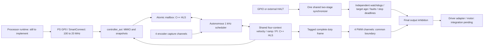

# Architecture, priorities and integration status — 2026-10-12

**Current update — 2026-10-17:** This review's revision-3/4 tables are historical.
Revision 6 (400 RPM) has passed full Arty routing and EDF integration. UIO and
encoder movement have been observed on the board. Version 0.6.0 now implements
the first exclusive kernel-access/lifecycle/velocity service and separate
maintenance menu; physical qualification remains pending. See
[commissioning](../software/linux/production.md) and [verification](verification.md).

The revision 0.18 shared-velocity architecture is implemented as an executable
FPGA controller, not yet as a qualified motor/vehicle system. Revision 3 has
complete-board routed timing evidence. Revision 4 consolidates HALT CDC and must
be regenerated and routed in the board design before inheriting that evidence.

## Current implementation

The HLS-first intent is retained: protocol semantics and motor algorithms are
C++ HLS. RTL handles AXI, scheduling/transport, encoder/PWM timing, CDC and
protection that must remain functional when HLS is stalled. The active shared
kernel is generated through the shared-mailbox preparation flow; legacy
position/ring sources in the tree do not describe the active velocity IP.

## Requirements versus implementation

| Architecture requirement | Implementation/evidence | Remaining gap |
|---|---|---|
| One shared engine, up to four independent motor contexts | Actual shared HLS kernel, adapter and autonomous scheduler; interleaved context reference tests | Worst-case complete-frame bound across all supported states/configurations |
| Processor owns trajectories, dwell, position completion and localization | FPGA velocity-only profile and host MMIO helpers exist | Production processor runtime, device access, trajectory/completion logic and loaded scheduling measurements |
| Atomic selected-motor targets, same-mask pending replacement | C++ atomic mailbox, generated ABI, real-HLS integration tests | Sustained bus-pressure and all reset/ownership overlap cases |
| Separate target age and authorization watchdog | Independent RTL timers; expiration/refresh and shared inhibition tests | Host publication/refresh jitter; full operating-envelope qualification |
| Common-tick capture and common-boundary PWM publication | Captured tags/snapshots; staged complete duty frame; late/faulted result rejection | Formal/exhaustive lifecycle races and measured worst-case arbitration latency |
| HALT/fault priority above disable, STOP and publication | Immediate protective gate and explicit recovery tests; revision 4 shares HALT synchronization | Updated board CDC/routing and external electrical latency qualification |
| Prepare/validate configuration while disabled | Structural staging/commit checks while core reset held; numeric preparation in HLS | Numeric validation currently occurs during initial enabled service before output release, not wholly before enable as specified |
| Immediate controlled STOP, then READY/zero drive | STOP accepted out of band, serviced after current complete frame; successful STOP and fault escalation tests | This boundary delay must be explicitly accepted/bounded against “immediate”; no claim of instantaneous ramp transition |
| No automatic restart; protective reset isolation | External/local latches and MMIO CORE_RESET separation; cold reset distinguished | Prove stale AXI drain/isolation across cold/fabric resets; peer enable/disable mid-frame stress |
| Full telemetry and sticky fault attribution | Coherent 64-bit position/time data and engine/watchdog status | Scheduler timing maxima are not exposed by the top; fault-class/batch-history diagnostics are incomplete relative to section 10 |
| Physical driver/supply/thermal/current/stall faults | Four generic synchronized physical inputs plus encoder/arithmetic/timer causes | Electrical polarity and class mapping; no claim all specified physical detection mechanisms exist |
| Numeric profile and minimum 1 RPM | Bounded arithmetic and estimator/PI tests, rational encoder scaling | 1 RPM under real load, gain/filter tuning, slip and measured stopping/position accuracy |
| Stable ABI after qualification | Generated provisional DMB1/DMI1 contracts and reference helpers | Do not freeze ABI until outstanding integration/diagnostic work passes |
| SmartHLS portability | Portable C++ design intent | Separate SmartHLS build, synthesis and integration qualification not complete |

Configuration pre-enable validation and STOP latency are implementation/requirement
mismatches to resolve, not silent changes to the architecture. The current safety
checks inhibit on invalid configuration; that does not satisfy the specified
lifecycle ordering by itself. Similarly, an observed 97.05 us target frame is not
a worst-case STOP or bus-service bound.

## Development priorities and milestones

The four integration priorities and the seven architecture stages are different
lists. Their status is:

| Milestone | Status |
|---|---|
| Priority 1: real engine/lifecycle adapter | Implemented and simulated; lifecycle edge qualification incomplete |
| Priority 2: actual generated-RTL integration | Implemented; both HLS kernels exercised with AXI/scheduler/PWM |
| Priority 3: encoder and independent protection | Implemented; shared HALT CDC update in revision 4; physical qualification pending |
| Priority 4: AXI/MMIO and host reference access | Implemented, optimized and tested; diagnostics/runtime/ABI freeze incomplete |
| Architecture stages 1–4: protocol, protection, scheduler, numerical/RTL verification | Substantial implementation and regression evidence; not exhaustive completion |
| Stage 5: complete-device implementation, latency and CDC | Revision 3 placed/routed; current constraints pass; CDC/external-I/O review and worst-case latency remain open |
| Stage 6: processor scheduling and vehicle control | Not qualified; helpers are not a production control runtime |
| Stage 7: electrical/loaded vehicle acceptance and SmartHLS | Not complete |
| First diagnostic Vivado IP milestone | Completed earlier; distinct from the real motor controller |
| Real IP export and processor-bus simulation | Completed; revision 4 is the current export |
| Safe powered-motor bring-up | Not yet qualified |

Revision 3 board evidence: placed utilization 34,319 LUTs, 52,176 registers,
16 DSPs and two RAMB36 tiles; routed setup slack +2.976 ns overall and +13.360 ns
in the 20 MHz domain, hold +0.007 ns. Those reports have no combinational loops
or standard DRC errors; CDC/methodology and external I/O intent still need work.
Do not mix these full-board numbers with the 34,129-LUT revision 3 OOC controller
or earlier HLS estimates. See [routed audit](routed_audit.md).

## Revision 4 HALT change

`motor_io` now contains one ASYNC_REG-marked, preserved two-flop HALT chain.
Four `dmotor_safety` instances consume its output through an explicit
already-synchronized parameter. Standalone safety users retain their default
internal synchronizer. Each motor retains its external latch and recovery rules;
MMIO CORE_RESET does not clear the shared chain or protective latches.

`constraints/controller_halt.xdc` is included in the packaged IP. It cuts only the
path into the shared first-stage D pin. It neither groups the clocks globally nor
cuts the inter-stage or downstream safety paths. Physical-fault synchronizers
now carry ASYNC_REG as well; their external pin/timing contracts still need review.
There are no new ports, registers or software requirements. GPIO still connects
directly to `halt_async`. The two-stage functional sampling delay is unchanged;
simulation does not model analog metastability or establish MTBF.

## Recommended next order

1. Upgrade the board to revision 4; verify the scoped constraint is applied and
   rerun CDC/methodology and implementation. Review vendor bundled-data crossings
   without overriding SmartConnect's datapath/skew constraints.
2. Resolve the external fault/encoder/output timing and electrical adapter contract,
   including inactive levels at configuration/reset/clock loss. GPIO HALT is not
   by itself an independently wired emergency-stop system.
3. Close pre-enable configuration validation, STOP response bounds, bus-reset
   isolation and peer lifecycle races; expose the missing timing/fault diagnostics.
4. Implement and load-test the processor publisher/watchdog/recovery runtime.
5. Perform inhibited bench checks, then controlled single-motor and multi-motor
   loaded tests. Measure the actual low-speed, stop and vehicle completion behavior.
6. Freeze the tested ABI and separately qualify the portability target.

Required external decisions remain driver wiring/polarity, fault class mapping,
current-limit settings and vehicle acceptance thresholds. These were not invented
or changed as part of this analysis.

## Revision 4 verification result

All 33 CTest regressions pass (191.97 s). The expanded full-controller XSim test
passes with both actual HLS kernels, including off-edge HALT assertion, identical
four-channel detection after the second stage, identical external latch capture,
blocked MMIO, no false local-HALT echo and explicit recovery. Export-time mailbox
XSim also passes.

Fresh complete-controller synthesis has zero LUTLP-1 violations and exactly two
shared HALT stage registers. Utilization is 34,132 LUTs, 50,405 registers, 16 DSPs
and two RAMB36 blocks. A scratch IP consumer confirms the packaged XDC is scoped
to its IP instance and enabled for synthesis and implementation. The first-stage
exception is present in the synthesis exception report. Evidence is under
`docs/evidence/shared_halt/`; reproduce the structural check with
`platforms/vivado/check_shared_halt.tcl`.

This is not a rerouted board result. A virtual input-clock diagnostic does not
replace CDC analysis from the real GPIO launch register in the upgraded board.
The original `dvrmc` project was not modified.

## Rebuilt revision 4 evidence — 2026-10-13

The new routed checkpoint confirms the HALT repair: TIMING-6/TIMING-7 and all
four CDC-11 violations are gone. HALT is one CDC-3 informational crossing with
two ASYNC_REG stages and its first-stage false path. Setup slack is +2.713 ns
(+12.072 ns in the controller domain), hold +0.025 ns, with no failing endpoints.
Two CDC-6 SmartConnect bundled-data warnings and 94 external-I/O timing warnings
remain; standard DRC contains only the 40 DSP pipeline warnings.

The implementation log also exposed unsupported `if`/`unset` commands in the
packaged HALT XDC. The false-path constraint itself applied, but the diagnostic
Tcl commands produced critical parser warnings. Revision **5** removes those
commands, retaining only the supported constraint. The corrected XDC parsed
successfully against the routed checkpoint; the archive was re-exported and its
mailbox simulation passed. There is no RTL change from revision 4. Original board
files/checkpoint were not modified. Upgrade the IP and regenerate output products
to consume this packaging correction. Evidence: `docs/evidence/routed_rev4/`.
