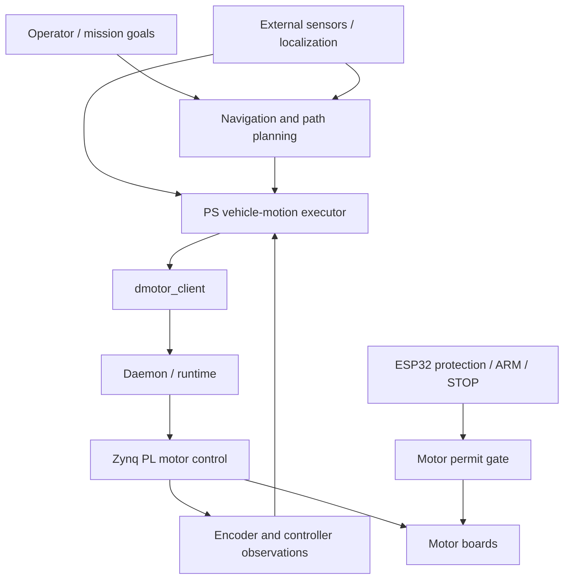

# Autonomous motion — architecture discussion

> Architecture update (2026-11-07): main uses the [1 ms PS motor executor](../DMOTOR_ARCH.md) with independent PL capture/PWM/protection and a matched PSF1 driver/daemon. Client contracts, commissioning-first scope, U0 evidence, the hardware pause and pending live recovery are unchanged.

Status: proposal for discussion, 2026-11-06. Robert has paused further hardware
testing until the monitor and motor boards are available and requested higher-level
architecture work. The commissioning-first release decision remains unchanged.
This document starts vehicle requirements/design; it does not accept BV/GV or
change the controller's motion-admission rules.

## Responsibility boundaries

The existing architecture puts vehicle behavior on the Zynq PS, velocity control
in PL and electrical protection on the ESP32. Extend that separation as follows:

| Layer | Responsibility | Boundary |
|---|---|---|
| Mission executive | Select goals, sequence actions, cancel or report failure | Issues identified goals, never raw motor writes |
| Navigation / perception | Estimate obstacles/free space and plan a path to a goal | Placement and sensor inputs remain undecided; may be a separate computer |
| PS vehicle-motion executor | Own an accepted local motion, track its trajectory, apply geometry and limits, report progress/completion | Sole normal motion client of `dmotor_client`; no competing maintenance owner |
| PS daemon/runtime | Validate ownership, recovery admission, deadlines and motor targets; publish coordinated batches | Sole kernel/controller owner; no bypass from navigation |
| Zynq PL | Deterministic motor velocity regulation, encoder observations and existing watchdog/protection response | No mission, map or path-planning logic |
| ESP32 monitor | Electrical sensing, permits, physical ARM/STOP and recovery participation | No route planning; missing operational firmware remains explicit |

This is an ownership proposal, not a claim that the mission/navigation/executor
components already exist. No middleware or additional compute platform is selected.

## Define three different commands

1. **Goal:** an intended destination or action, with a coordinate frame, goal ID,
   tolerance and deadline. It may need replanning and is not a velocity command.
2. **Trajectory:** a bounded, time-indexed local motion with explicit validity,
   limits and cancellation semantics. It is owned by the vehicle executor.
3. **Motor targets:** short-lived coordinated velocities published through the
   daemon. Fresh batch numbers alone do not demonstrate fresh planner intent.

For the first software milestone, propose local relative motions (move a distance,
turn an angle, dwell, cancel) in simulation. Map navigation and obstacle avoidance
can follow after the executor, feedback and failure semantics are established.
These are vehicle-frame motions; per-wheel encoder displacement alone cannot prove
vehicle displacement when tracks/wheels slip.

## Feedback, ownership and stopping

Keep measured wheel odometry separate from externally corrected vehicle pose.
Every observation needs units, frame, source time, receipt time, validity and reset
identity. Preserve fractional encoder conversion; do not integrate a counter reset
as displacement. Localization corrections must not silently change the meaning of
an active relative goal. Map-frame goals require a defined map-to-local transform
and an explicit policy for jumps or stale localization.

Proposed initial ownership: one normal vehicle executor holds the daemon client
connection; maintenance requires explicit handover while stopped/inhibited. Never
let two planners independently refresh different interpretations of the same goal.
The executor must not keep publishing an abandoned target just to satisfy freshness.
Define independent deadlines for upstream command validity, planner progress,
localization and actuator delivery. The existing commissioning lease/timing values
are inputs for review, not automatically the autonomy contract.

On cancellation, expire the goal and its queued work, request the appropriate
controlled STOP, observe stopping and report cancelled. Faults or loss of the
ability to stop normally escalate through existing HALT/protection behavior.
Completion requires measured tolerance and settling after stopping; accepted or
applied motor targets are not goal completion. The current runtime requires rearm
after STOP/disable: account for that between motions rather than assuming seamless
queued moves or persistent position hold already works.

Loss of planner/pose should default to stopping in the initial proposal. Continuing
a previously accepted trajectory during a disconnected mission client would need
an explicit bounded execution/ownership policy; it is not authorized by this draft.
Restart, recovery or physical ARM must never resume an old mission automatically.
Obstacle stopping additionally needs sensor coverage, age and measured stopping
capability; electrical protection alone cannot provide collision avoidance.

## Decisions to make next

| Question | Why it matters |
|---|---|
| First autonomous task: local distance/turn sequence, waypoint navigation, or another behavior? | Determines the smallest useful goal API and feedback requirements |
| Vehicle geometry: tracked/skid-steer or another layout; which of four motors drive each side? | Defines kinematics, saturation and encoder mapping; earlier PS plans mention a tracked vehicle, but actual geometry needs confirmation |
| Available localization and obstacle sensors? | Determines whether only wheel-relative motion or externally referenced navigation is supportable |
| Where will mission/perception/navigation execute: Zynq PS or an external host? | Determines transport, clock handling and disconnect semantics; hardware choice remains open |
| Required accuracy, speed, operating area and behavior on uncertainty? | Sets acceptance limits; no numeric limits are invented here |

## Work that can proceed without boards

Start with the first task and geometry decisions, then specify goal/result types,
coordinate frames and command lifecycle. Build a fake-clock vehicle simulator and
executor tests for cancellation, ownership loss, stale pose, reset discontinuity,
slip, saturation and stop overshoot. Exercise the client boundary with a fake daemon;
keep simulation-only values clearly labelled. Only after those contracts are
reviewed should we select dependencies and implement a normal executor.

Hardware validation resumes with the [U1 procedure](u1_gpio_bench.md) and the
remaining [G2 checks](gates/G2.md) when assembled boards are available. Physical
vehicle claims wait for G6 and GV. See [archived PS Phase 5](archive/pre-ps-executor-2026-11-07/DMOTOR_SW.md#phase-5--processor-owned-motion-and-vehicle-state)
and [BV in the system plan](system_bringup_plan.md) for the retained scope.
