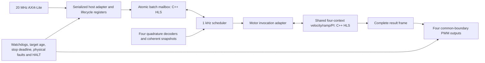

# Integrated controller: priorities 1–4 implementation

The first complete logical control path is now implemented in
`rtl/controller_axi.sv`. It connects AXI4-Lite, the actual atomic-mailbox HLS IP,
the scheduler, the actual shared four-context motor HLS IP, four encoder channels,
independent authorization/target-age protection and four PWM outputs. It is an
integration preview with a provisional register map, with revision 3 routed evidence but not a board-qualified
controller. The separate DMD1 diagnostics endpoint is unchanged.



## Priority 1: engine/lifecycle adapter

`motor_engine_adapter.sv` resets/prepares a selected context on its first enabled
service, then executes ordinary periodic ticks. Warm-up readiness is derived from
actual engine status. A new target requires four staging writes, commit and tick;
all responses and actual per-motor applied sequence are checked before returning
a successful tagged duty. Per-context internal publication sequences are separate
from the global batch sequence. Sequence exhaustion faults rather than wrapping.
Motor arithmetic and algorithm state remain in the measured C++ HLS kernel.

STOP is latched by the processor interface and serviced at the next complete
control-frame boundary. An already executing frame finishes; the request is not
lost or rejected because the engine is busy. This boundary policy avoids skipping
an HLS tick, which would violate its exact 1 kHz timing contract. STOP closes target
admission, invalidates pending intent, disarms target age and uses the existing
HLS deceleration/settling behavior. STOP completion requires zero ramp and duty.
STOP remains latched until an explicit disabled controller reset/rearm. HALT and
disable do not wait for this controlled-stop boundary.

Independent stop-deadline monitoring uses the configured stop timeout. A hung call
also encounters the independent frame deadline. Admission now waits for protocol
invalidation cleanup rather than dropping a tick before any motor has executed.
Cancellation after partial context execution remains fail-closed; no context
rollback is claimed. Routine per-channel enable/disable changes during a frame
still require further stress qualification, including their effect on peer ticks.

## Priority 2: actual generated-RTL integration

`sim_integrated.tcl` runs both real HLS kernels with the scheduler, target age and
PWM. It checks warm-up, four-channel target acceptance, common output release,
STOP and inhibit. The tested new-target frame took **1,941 cycles / 97.05 us** at
20 MHz, below the 16,000-cycle frame deadline. This is one observed scenario, not
a new worst-case proof or resource estimate.

## Priority 3: encoder and independent protection

`motor_io.sv` adds four X4 quadrature decoders/snapshot collectors, four authorization
watchdogs, synchronized physical-fault inputs, external HALT and a shared latched
local HALT aggregator. Each motor's capture includes count, edge time, direction
epoch, invalid-transition count and capture fault. Snapshots are captured by the
scheduler at the effective frame tick.

Qualified physical faults, watchdog/stop expiry and computation faults inhibit all
motors. External HALT inhibits and latches separately without echoing a fabricated
local HALT source. Controller reset does not clear protective latches. Recovery is
explicit: disable, hold controller reset, correct sources, acknowledge local causes,
acknowledge shared HALT, release external HALT, acknowledge external latches, select
a drained session, release controller reset, and explicitly enable.

The top-level `reset` is a cold/protective reset and clears the protection state;
it requires external inhibition and coordinated bus reset. It is not an arbitrary
software peripheral reset. MMIO CORE_RESET preserves protection but resets motor,
mailbox and encoder/time epochs. Position counters restart at zero; host odometry
must record the discontinuity. Electrical driver pin polarity/coast circuitry and
reset-time board behavior remain integration work.

## Priority 4: AXI/MMIO and host reference access

The endpoint is a 32-bit AXI4-Lite slave in the **20 MHz domain**, with independent
AW/W buffering, separate read/write response backpressure and serialized downstream
operations. Use the tested dual-clock SmartConnect connection to the existing 100 MHz bus.
Addresses below 0x1000 retain the DMB1 atomic-mailbox ABI. Blocked atomic accesses
return SLVERR instead of hanging during HALT/reset. Local status/recovery registers
remain accessible. Full aligned writes with WSTRB=0xf are required.

The integrated ABI is generated from `abi/controller.json` into C++ and SV constants.
The DMI1 identity lives at offset 0x1000; atomic identity remains at offset zero.
All offsets are peripheral-relative; no address was assigned in the user's dvrmc BD.

| Offset | Register | Contract |
| --- | --- | --- |
| 0x1000 | IDENTITY | Read 0x444D4931 (DMI1) |
| 0x1004 | STATUS | Enabled[3:0], configured[7:4], ready[11:8], stopped[15:12], fault[16], local shared HALT[17], blocked[18], per-motor target-age faults[22:19] |
| 0x1008 | SESSION | Nonzero; writable while disabled and core reset held |
| 0x100c | ENABLE | Write motor mask; watchdog arms and HLS initialization/warm-up follows |
| 0x1010 | DISABLE | Write motor mask |
| 0x1014 | STOP | Write motor mask; latched until disabled reset/rearm |
| 0x1018 | REFRESH_SESSION | Session for subsequent watchdog refresh strobes |
| 0x1020 | CORE_RESET | Write 1 to hold, 0 to release; all motors disabled; nonzero session required |
| 0x1024 | ACKNOWLEDGE | Bit 0 local causes, bit 1 shared aggregator, bit 2 external latches; issue in recovery order |
| 0x1028 | WATCHDOG_CYCLES | Disabled-only timeout; 1 ms–10 s at 20 MHz |
| 0x102c | TARGET_TIMEOUT_CYCLES | Disabled/core-reset-only target timeout |
| 0x1030 | SNAPSHOT | Write 1 to capture coherent telemetry; read capture sequence |
| 0x1040 + 4*m | REFRESH | Write next watchdog sequence for motor m |
| 0x2000 + 0x100*m | CONFIG | Twenty staging words; all must be written with core reset held |
| CONFIG + 0x80 | COMMIT | Write 1; full staging and nonzero generation required |
| 0x3000 + 84*m | TELEMETRY | Captured 21-word record for motor m |

Configuration commit establishes a complete candidate; numeric validation remains
in HLS during initial service before output release. An invalid candidate faults
rather than enabling drive. Do not interpret configured status as numeric acceptance;
wait for actual readiness while servicing the watchdog. Initial default watchdog and
target-age limits are 100 ms; the watchdog must also be refreshed throughout warm-up.
No live configuration retuning is supported.

Telemetry words 1–13 preserve engine reply fields, including applied sequence,
duty, ramp, measured velocity, validity/acquisition flags, faults and rejection
bits. Word 0 is the last requested velocity (zero after STOP request); words 14–15
are the effective sample tick. Words 16–17 are signed encoder position, 18 watchdog/
physical fault bits, 19–20 first-fault time. Capture once, then read the bank. Access
requires a single serialized host owner; hardware does not arbitrate multiple
software snapshot writers.

`include/dmotor/controller_host.hpp` provides session, configuration, refresh and
telemetry helpers on the same device-I/O abstraction as `batch_host.hpp`. It does
not provide Linux device-tree setup, a kernel driver or processor trajectory code.
The I/O provider must perform device-memory access and ordering, not ordinary cached
loads/stores. Cold-reset outstanding AXI transaction isolation remains a platform
integration obligation before sessions may be reused.

## Reproduce and qualify

```sh
python3 tools/generate_controller_abi.py --check
cmake -S . -B build/atomic_protocol
cmake --build build/atomic_protocol -j2
ctest --test-dir build/atomic_protocol --output-on-failure
/opt/vitis/2026.1/Vivado/bin/vivado -mode batch -source platforms/vivado/sim_integrated.tcl
/opt/vitis/2026.1/Vivado/bin/vivado -mode batch -source platforms/vivado/sim_controller_axi.tcl
/opt/vitis/2026.1/Vivado/bin/vivado -mode batch -source platforms/vivado/export_current.tcl
```

The AXI XSim test uses both real HLS blocks. It covers configuration, write rejection
while enabled, four-motor publication, coherent telemetry, STOP requested during
computation, actual Gray-code capture, shared physical fault, explicit recovery,
watchdog expiry and external-HALT access/recovery without HALT echo. The previous
33-test regression passes; affected mailbox and host/ABI tests were rerun after
admission cleanup changes. Evidence is in `docs/evidence/priority_integration/`.

An encoder pulse-burst followed by silence during STOP triggered the existing HLS
acquisition fault under the accelerated test configuration; shared HALT responded.
Successful STOP is tested separately with stationary feedback. This is not a motor
plant simulation or evidence of mechanical stopping performance.

The integrated IP is packaged as `controller_axi.zip`, VLNV
`dmotor.org:user:controller_axi:0.18`. Prior component exports remain available.
Priorities 1–4 now have an executable integrated implementation, but qualification
is not complete: adversarial lifecycle/configuration timing, realistic feedback,
full reset isolation and operating-envelope tests remain. MMIO is still provisional.
Revision 3 completed board synthesis/place-and-route with passing specified timing.
Revision 4 must repeat board implementation after the shared HALT CDC update.
CDC/external-I/O closure, driver integration and powered motor tests remain open.
No component resource estimate is presented as integrated utilization.

## Vivado board-project validation

The 2026-10-12 `dvrmc` synthesis audit found device-capacity, combinational-loop,
and external fault-pin constraint blockers. See [the validation report](dvrmc_validation.md)
before attempting implementation or motor bring-up. Passing functional simulation
does not establish that this integration preview fits the XC7Z020.

Protection-loop follow-up: the [scheduler/arbiter repair](protection_feedback.md)
now passes fresh complete-controller out-of-context LUTLP-1 checks with zero
violations. Updated IP is version 0.18, core revision 2. The original board-audit
reports remain historical evidence; LUT capacity and fault-pin constraints are
still unresolved.

MMIO optimization update (2026-10-12): [fixed bank decoding](mmio_logic.md)
reduces the controller from 72,104 to **34,129 LUTs**, with zero LUTLP-1 violations
and passing expanded AXI/HLS simulation. The controller archive is now core
revision **3** (version 0.18). Earlier resource-overflow reports are historical;
board-level regeneration, implementation and physical fault-pin constraints
remain outstanding.

Current architecture/milestone analysis and revision 4 shared HALT CDC details:
[architecture_status.md](architecture_status.md).
