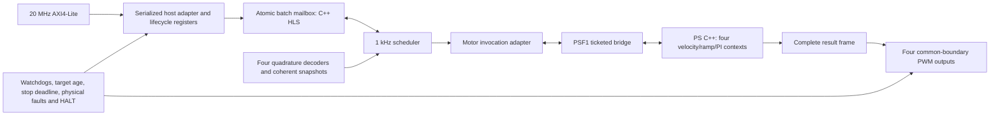

# Controller AXI and PS/PL integration

Current board-status addition: [SW0 maintenance inhibit, LD4/LD5 and ESP32 heartbeat LEDs](board_heartbeat.md). Synthetic HB/LED visual checks are operator-confirmed; see [operator-confirmed synthetic heartbeat/LED checks](evidence/board_heartbeat/physical_confirmation_2026_11_08.md). Electrical timing and full interlock qualification remain pending.

> Current main: PSF1 motor execution runs on the PS at 1 ms; the atomic mailbox, scheduler, PWM and protection remain in PL. See [current architecture](../DMOTOR_ARCH.md) and [PSF1 contract](ps_executor.md). Older component measurements below retain their original scope.

> Current product builds: [build guide](build.md). Earlier HLS integration measurements
> are retained in the linked historical record.


`rtl/controller_axi.sv` connects AXI4-Lite, atomic-mailbox HLS, the 1 kHz
scheduler, the PSF1 motor transaction bridge, four encoder channels, independent
protection and four PWM outputs. The C++ motor contexts execute in the daemon on
Zynq PS. Board ports and public DMI2/DMB1 registers are retained; physical system
qualification remains open. The separate DMD1 diagnostic endpoint is unchanged.



## Priority 1: engine/lifecycle adapter

`motor_engine_adapter.sv` resets/prepares a selected context on its first enabled
service, then executes ordinary periodic ticks. Warm-up readiness is derived from
actual engine status. A new target requires four staging writes, commit and tick;
all responses and actual per-motor applied sequence are checked before returning
a successful tagged duty. Per-context internal publication sequences are separate
from the global batch sequence. Sequence exhaustion faults rather than wrapping.
Motor arithmetic and algorithm state reside in the C++ PS worker. Staging, commit
and tick are fused into one private PS transaction, preserving their execution
order and reply validation. The worker commits speculative state only after
hardware accepts the matching ticket; a partially executed frame still has no
whole-frame rollback guarantee.

STOP is latched by the processor interface and serviced at the next complete
control-frame boundary. An already executing frame finishes; the request is not
lost or rejected because the engine is busy. This boundary policy avoids skipping
a motor-control tick, which would violate its exact 1 kHz timing contract. STOP closes target
admission, invalidates pending intent, disarms target age and uses the existing
PS controller deceleration/settling behavior. STOP completion requires zero ramp and duty.
STOP remains latched until an explicit disabled controller reset/rearm. HALT and
disable do not wait for this controlled-stop boundary.

Independent stop-deadline monitoring uses the configured stop timeout. A hung call
also encounters the independent frame deadline. Admission now waits for protocol
invalidation cleanup rather than dropping a tick before any motor has executed.
Cancellation after partial context execution remains fail-closed; no context
rollback is claimed. Routine per-channel enable/disable changes during a frame
still require further stress qualification, including their effect on peer ticks.

## Priority 2: actual PS/PL integration

The product pipeline runs full-controller AXI and CLN1 cleanup co-simulation
using actual atomic HLS, production RTL and the real PS C++ engine through VPI.
It checks four-motor publication, coherent output release, STOP, faults, reset,
cleanup interruption and direct-duty behavior. This proves simulated behavior;
it does not measure Linux execution latency. The **800 us full-frame deadline**
and **1 ms control period** remain unchanged and require target load testing.

## Priority 3: encoder and independent protection

`motor_io.sv` adds four X4 quadrature decoders/snapshot collectors, four authorization
watchdogs, synchronized physical-fault inputs, external HALT and a shared latched
local HALT aggregator. Each motor's capture includes count, edge time, direction
epoch, invalid-transition count and capture fault. Snapshots are captured by the
scheduler at the effective frame tick.

Qualified physical faults, watchdog/stop expiry and computation faults inhibit all
motors. External HALT inhibits and latches separately without echoing a fabricated
local HALT source. Controller reset does not clear protective latches. Recovery is
explicit: disable, hold controller reset, correct sources, acknowledge local causes,
acknowledge shared HALT, release external HALT, acknowledge external latches, select
a drained session, release controller reset, and explicitly enable.

### System physical-fault sources

An [isolated RTL evaluation](physical_fault_evaluation.md) found no meaningful
resource benefit from moving these latches into a shared register; current product
RTL is retained. System-source assignments below do not require that refactor.

`physical_faults[3:0]` identifies four **system-level fault sources**, not four
motor-specific fault wires. Any asserted source inhibits all motors and requests
shared HALT/coast. Source numbers must not be interpreted as motor numbers.

| Controller input | Assigned system source | Integration status |
|---|---|---|
| `physical_faults[0]` | Bumper contact, reported by MCP23017 interrupt | Assigned; external routing pending |
| `physical_faults[1]` | Reserved / unassigned | Keep inactive until assigned |
| `physical_faults[2]` | Reserved / unassigned | Keep inactive until assigned |
| `physical_faults[3]` | Reserved / unassigned | Keep inactive until assigned |

The controller boundary is active-high and includes input synchronization. For an
active-low MCP23017 interrupt, invert polarity at the board adapter boundary.
The PS reads the expander over I2C to identify the contact location; that read may
clear the expander interrupt but must not clear the controller's latched fault or
restart motion. PS interrupt notification is a separate integration connection.
Bumper-input configuration, initial-state checks and physical timing qualification
remain required before deployment. HALT/coast removes drive; it is not a measured
braking-distance guarantee.

**Existing telemetry layout is unchanged:** source `i` is stored in bit 2 of
telemetry word 18 in channel bank `i`, with that bank's existing first-fault time.
This is a storage mapping, not motor attribution. For example, bank 0's physical
fault bit means **bumper contact**, not a motor-0 fault. Other bits in the bank
retain their existing meanings; the bank's first-fault timestamp is shared with
its other fault causes, not a new dedicated bumper timestamp. Local and shared
HALT acknowledgement remain explicit, with asserted sources taking precedence.

The saved Arty BD still ties all four inputs low. This assignment changes the
documented system meaning; it does not claim the bumper is already wired or
implemented on Zybo. No RTL, register layout or external port name changes are
introduced by this documentation update.

The top-level `reset` is a cold/protective reset and clears the protection state;
it requires external inhibition and coordinated bus reset. It is not an arbitrary
software peripheral reset. MMIO CORE_RESET preserves protection but resets motor,
mailbox and encoder/time epochs. Position counters restart at zero; host odometry
must record the discontinuity. Electrical driver pin polarity/coast circuitry and
reset-time board behavior remain integration work.

## Priority 4: AXI/MMIO and host reference access

The endpoint is a 32-bit AXI4-Lite slave in the **20 MHz domain**, with independent
AW/W buffering, separate read/write response backpressure and serialized downstream
operations. Use the tested dual-clock SmartConnect connection to the existing 100 MHz bus.
Addresses below 0x1000 retain the DMB1 atomic-mailbox ABI. Blocked atomic accesses
return SLVERR instead of hanging during HALT/reset. Local status/recovery registers
remain accessible. Full aligned writes with WSTRB=0xf are required.

The integrated ABI is generated from `abi/controller.json` into C++ and SV constants.
The DMI2 identity lives at offset 0x1000; atomic identity remains at offset zero.
All offsets are peripheral-relative; no address was assigned in the user's dvrmc BD.

| Offset | Register | Contract |
| --- | --- | --- |
| 0x1000 | IDENTITY | Read 0x444D4932 (DMI2) |
| 0x1004 | STATUS | Enabled[3:0], configured[7:4], ready[11:8], stopped[15:12], fault[16], local shared HALT[17], blocked[18], per-motor target-age faults[22:19] |
| 0x1008 | SESSION | Nonzero; writable while disabled and core reset held |
| 0x100c | ENABLE | Write motor mask; watchdog arms and PS context initialization/warm-up follows |
| 0x1010 | DISABLE | Write motor mask |
| 0x1014 | STOP | Write motor mask; latched until disabled reset/rearm |
| 0x1018 | REFRESH_SESSION | Session for subsequent watchdog refresh strobes |
| 0x1020 | CORE_RESET | Write 1 to hold, 0 to release; all motors disabled; nonzero session required |
| 0x1024 | ACKNOWLEDGE | Bit 0 local causes, bit 1 shared aggregator, bit 2 external latches; issue in recovery order |
| 0x1028 | WATCHDOG_CYCLES | Disabled-only timeout; 1 ms–10 s at 20 MHz |
| 0x102c | TARGET_TIMEOUT_CYCLES | Disabled/core-reset-only target timeout |
| 0x1030 | SNAPSHOT | Write 1 to capture coherent telemetry; read capture sequence |
| 0x1040 + 4*m | REFRESH | Write next watchdog sequence for motor m |
| 0x2000 + 0x100*m | CONFIG | Twenty staging words; all must be written with core reset held |
| CONFIG + 0x80 | COMMIT | Write 1; full staging and nonzero generation required |
| 0x3000 + 84*m | TELEMETRY | Captured 21-word record for motor m |

Configuration commit establishes a complete candidate; numeric validation remains
in PS C++ during initial service before output release. An invalid candidate faults
rather than enabling drive. Do not interpret configured status as numeric acceptance;
wait for actual readiness while servicing the watchdog. Initial default watchdog and
target-age limits are 100 ms; the watchdog must also be refreshed throughout warm-up.
No live configuration retuning is supported.

Telemetry words 1–13 preserve engine reply fields, including applied sequence,
duty, ramp, measured velocity, validity/acquisition flags, faults and rejection
bits. Word 0 is the last requested velocity (zero after STOP request); words 14–15
are the effective sample tick. Words 16–17 are signed encoder position, 18 watchdog/
physical fault bits, 19–20 first-fault time. Physical source `i` uses bit 2
of word 18 in bank `i`; see [system source assignments](#system-physical-fault-sources). Capture once, then read the bank. Access
requires a single serialized host owner; hardware does not arbitrate multiple
software snapshot writers.

`include/dmotor/controller_host.hpp` provides session, configuration, refresh and
telemetry helpers on the same device-I/O abstraction as `batch_host.hpp`. It does
not provide Linux device-tree setup, a kernel driver or processor trajectory code.
The I/O provider must perform device-memory access and ordering, not ordinary cached
loads/stores. Cold-reset outstanding AXI transaction isolation remains a platform
integration obligation before sessions may be reused.

## Reproduce and qualify

```sh
python3 tools/generate_controller_abi.py --check
python3 tools/build.py project
```

The required pipeline includes native/controller/RTL tests, atomic HLS C/RTL
co-simulation, PS software/client tests, and actual PS-C++/full-controller AXI and
cleanup co-simulation. EDF then routes the board and builds the matched ARM image.
See [build instructions](build.md), [verification](verification.md) and
[current resource, timing and artifact evidence](system_status.md).

The packaged controller remains `dmotor.org:user:controller_axi:0.18`, now core
revision 13. Earlier revision-1–4 HLS integration measurements and board-validation
findings remain in the [historical integration record](archive/pre-ps-executor-2026-11-07/controller_axi.md).
They are not current resource or timing measurements. Physical qualification,
loaded Linux deadlines, lifecycle stress and electrical behavior remain open.

## Revision 13 private PSF1 executor extension

Offsets **0x4000–0x417c** inside the existing 64 KiB AXI window carry identity,
cadence, immutable request tickets, the captured 35-word record and staged
16-word replies. They are private to the matched daemon/driver. The public
client API and DMI2/DMB1 offsets are unchanged. See the complete
[PSF1 register and cancellation contract](ps_executor.md).

## Revision 7 direct-duty extension

The endpoint identity is DMI2; software/driver must be upgraded with the bitstream.
The normal mailbox remains DMB1. Direct mode holds the motor invocation path reset
and selects a separate single-channel PWM path using the same PWM primitive and
shared protection chain. All nonselected motors remain disabled.

| Offset | Register | Contract |
|---|---|---|
| 0x1050 | DIRECT_CAPABILITY | Read 0x44445531 (`DDU1`) |
| 0x1054 | DIRECT_MODE | 0 = velocity, or one-hot motor mask 1/2/4/8; write only disabled under core reset |
| 0x1058 | DIRECT_LIMIT | Absolute Q16 duty ceiling, 0..65536; write only disabled under core reset |
| 0x105c | DIRECT_DUTY | Stage signed Q16, reject outside ceiling; read last accepted command |
| 0x1060 | DIRECT_COMMIT | Write strictly increasing nonzero sequence; read last accepted sequence |

Commit requires direct mode, selected motor enabled, no STOP/HALT/fault, and core
reset released. Replays are rejected and cannot refresh the command-age timer.
Core reset clears staging, sequence and drive intent. The command-age timer uses
TARGET_TIMEOUT_CYCLES and expires even at zero duty; expiry wins at the boundary.
STOP immediately disables direct drive. Physical output duty is latched at PWM
boundaries with existing reversal blanking. A core-reset-only recovery does not
clear protective latches; acknowledgment/rearm is still required.

The host's optional nonzero duty floor is not an FPGA interlock. Zero is always
allowed; limit and floor changes require service restart/rearm. See
[commissioning](../software/linux/direct-duty.md).

## Revision 9 monitor supervision

The controller now requires qualified `hb_async` before enable, and combines its
sticky monitor fault into the outward `coast_req` output. Existing physical
faults and drive_enable remain. Revision 10 registers drive_enable for GPIO
diagnostics, adding one controller-clock delay to that readout while leaving
PWM/coast protection unchanged. See [PL monitor integration](pl_monitor_progress.md)
for MONITOR_CAPABILITY/STATUS/ACK (0x1064/0x1068/0x106C), disabled/reset recovery,
software compatibility and test evidence. This is not the UART/ARM interlock.

## Revision 11 disabled cleanup

CLN1 adds a disabled startup sweep after CORE_RESET release in velocity mode.
The scheduler/PWM remain inhibited until atomic-mailbox initialization/drain and
four acknowledged motor-context resets complete. No channels are enabled by cleanup.
Existing per-channel readiness acquisition still follows explicit ENABLE.

| Address | Register | Read-only semantics |
|---|---|---|
| 0x1070 | CLEANUP_CAPABILITY | `0x434c4e31` (CLN1) |
| 0x1074 | CLEANUP_STATUS | bit 0 pending, bit 1 valid completion, bit 2 failed, bit 3 unsupported direct-duty mode; reset returns 0 in velocity mode |
| 0x1078 | CLEANUP_SESSION | Completed session while completion is valid, otherwise 0 |
| 0x107c | CLEANUP_REQUEST | Fabric-lifetime count of accepted CORE_RESET releases; starts at 0; never wraps |

CORE_RESET=0 now requires an asserted reset and a non-exhausted request counter.
Repeated releases return SLVERR. Request identity survives core reset but not fabric
reset; it is not a persistent peer/session lifetime ID. Session/configuration are
captured by the sequencer; configuration remains writable only while core reset is
asserted. Completion becomes invalid on reset, configuration/session change,
inhibit/fault, enable or a mutating mailbox request. Disable does not restore it.
A failed active sequence requires reset/retry; it never admits motion.

The primitive runs unauthorized reset-only commands even for unconfigured channels;
this does not relax validation before operation. Direct-duty mode keeps the shared
engine reset and reports unsupported, so it cannot supply this recovery attestation.
PS velocity preparation requires CLN1 and verifies request/session/completion, while
the driver requires CLN1 at probe and allows read-only access. See the
[cleanup contract and qualification limits](g1a_cleanup_admission.md#8-combined-cln1-integration).
Revision 13 requires a matched PSF1 driver, daemon and hardware build. Current PS/PL and
routed evidence is linked from [system status](system_status.md); earlier revision
evidence does not qualify the new reset-ownership path. No new external block-diagram ports are added.
