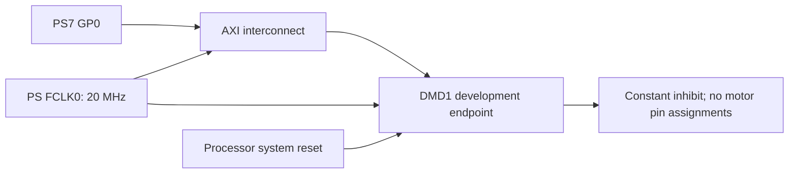

# First Vivado milestone: permanently inhibited development IP

> For the current Arty `platforms/arty-z7-20/vivado/create.tcl` invocation, see
> [Recreate and open the current project](build.md#recreate-and-open-the-current-project).
> Current product builds: [build guide](build.md). Commands below are specialized
> component/experiment reproduction or historical evidence, not the default build.


This milestone provides a small AXI4-Lite peripheral for the XC7Z020 and a separate
Arty Z7-20 reference block design. It deliberately does not instantiate the motor
engine or accept motion commands. PWM, direction and drive-enable outputs are tied
to zero; logical inhibit is tied to one, including during reset. Its configuration
register is development readback storage, not motor configuration.

The existing `~/workspace/dvrmc` project was not modified. Its Arty Z7-20 board
identity informed the new reference. This is not a ZC702 design.

## Reproduce and open

From the dmotor repository:

```sh
/opt/vitis/2026.1/Vivado/bin/vivado -mode batch -source platforms/vivado/build_dev.tcl
/opt/vitis/2026.1/Vivado/bin/vivado -mode batch -source platforms/vivado/create_dev_bd.tcl
/opt/vitis/2026.1/Vivado/bin/vivado build/vivado_dev_bd/dmotor_dev_bd.xpr
```

The scripts recreate their generated projects under `build/`; make persistent edits
in the scripts, not those generated projects. The first script packages
`dmotor.org:user:dmotor_dev:1.0` at `build/vivado_dev/ip`, then synthesizes, places and
routes the endpoint out of context. The second uses the installed Arty Z7-20 board
preset, generates the block design and wrapper, and validates addresses/connections.
It requires board `digilentinc.com:arty-z7-20:part0:1.1`; the board-store location
matches the inspected reference environment and can be adjusted in the script.

The development block design connects PS7 GP0 through AXI automation to the new
endpoint, with PS FCLK0 and the AXI domain at 20 MHz and processor-system reset
logic generated by automation. No motor pins are exported. The logical motor
outputs remain unconnected in this development BD.



Do not wire this endpoint into the original reference project's 100 MHz domain
while retaining its 20 MHz clock declaration. Use a real 20 MHz peripheral domain
and a supported AXI clock crossing, or the separate generated development project.
The packaged endpoint clock-frequency parameter describes hardware; it does not
create or divide a clock.

## Development register contract

Base address in the generated project: **0x43C00000**, range **64 KiB**. Offsets
below are peripheral-relative. This is a distinct provisional ABI, not the DMB1
atomic mailbox or the legacy ring ABI.

| Offset | Name | Access | Meaning |
| --- | --- | --- | --- |
| 0x00 | ID | RO | 0x444D4431, DMD1 |
| 0x04 | Version | RO | 1 |
| 0x08 | Status | RO | 1: permanently inhibited; motor engine absent |
| 0x0c | Clock | RO | 20,000,000 Hz default |
| 0x10 | Scratch | RW | Full-word readback test; resets to zero |
| 0x14 | Development configuration | RW | Readback storage only; no hardware action |
| 0x18 | Cycles | RO | Wrapping 32-bit clock counter; reset clears it |

Aligned full-word accesses only. Unknown/misaligned addresses, writes to read-only
registers and writes with strobes other than 0xf return SLVERR without side effects.
AW and W are independently buffered. Read/write responses remain stable under
backpressure. Reset clears outstanding local requests; system integration must
coordinate AXI master/interconnect reset rather than reset the slave during traffic.

For board diagnostics, `python3 tools/dev_probe.py /dev/uioX` checks the identity
before writing scratch and restores the old scratch value. It requires a Linux UIO
map0 configured for this endpoint with device-memory attributes and exclusive
access. No Linux/device-tree setup or board execution has been performed. This
probe is not the future production motor driver.

## Verification and physical evidence

The AXI test passes split AW/W arrival in both orders, stalled read/write responses,
invalid access rejection, concurrent read progress during a stalled write response,
reset with an unmatched address, and permanently inhibited motor outputs. It is
registered as `rtl_vivado_dev`; both generated ABI checks also pass. Existing motor
algorithms were unchanged and the lengthy motor-engine regression was not rerun.

Vivado 2026.1 packaged the IP, validated/generated the reference BD, and completed
out-of-context endpoint placement/routing on `xc7z020clg400-1`:

- 82 LUT, 186 FF.
- Setup slack +37.867 ns; hold slack +0.168 ns.
- 50 ns clock and assumed 5 ns synchronous input/output delays.

These figures apply only to this diagnostics endpoint. OOC external ports have
no assigned partition-pin locations; Vivado warns that their boundary routing is
not complete. These are not full-board timing or resource results. The complete
PS/interconnect reference design has not been routed and no bitstream was generated.
Evidence is retained in `docs/evidence/vivado_development/`.

The Arty board preset raises Vivado PSU-1/PSU-2 warnings for negative DDR DQS-to-clock
skew values (-0.009 and -0.033). The preset was not silently changed. Review these
against the target board and known-working PS settings before board boot qualification.

## Remaining integration

Next connect the actual mailbox/motor architecture behind a separately versioned
control interface, add encoder/configuration/lifecycle/authorization integration,
and prove complete generated-RTL operation. Then implement the complete board
project, review physical I/O and DRV8263H electrical polarity/coast behavior, and
perform inhibited hardware diagnostics before powered motor testing. A constant
logical inhibit in this development IP is not a verified electrical driver-disable
circuit or a claim about FPGA pins before configuration.
